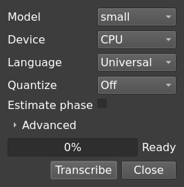

# Command-line tools

[README](../README.md) · [Editor guide](usage.md) · [Lyrics](lyrics.md)

Examples below assume the source checkout and `uv sync --extra cpu` setup. Prefix commands
with `uv run` in that environment. `namioto-cli` runs tasks without a GUI; `namioto-ctl`
controls an already running editor.

```bash
uv run namioto-cli --help
uv run namioto-cli spectrum --help
```

Use each command's `--help` for its complete options.

## Spectrum and tempo

```bash
uv run namioto-cli spectrum song.mp3
uv run namioto-cli spectrum song.mp3 --bench
uv run namioto-cli spectrum song.mp3 --threshold 1.2
uv run namioto-cli wavetone song.mp3
uv run namioto-cli tempo song.mp3
uv run namioto-cli tempo song.mp3 --local
uv run namioto-cli tempo song.mp3 --json
uv run namioto-cli tempocnn song.mp3
```

Spectrum analyses 84 bands (C1–B7); `--bench` adds timings and `--threshold` adds detected
note spans. WaveTone's volume-envelope estimator is the editor default. `tempo` uses a
librosa beat tracker and least-squares fit; local estimates use 12-second windows, 6 seconds
apart. JSON output includes beats. TempoCNN works best on full mixes rather than stems.

## Extract singing-voice notes

```bash
uv run namioto-cli game song.wav --language zh
uv run namioto-cli game song.wav --size medium
uv run namioto-cli game song.wav --device gpu
uv run namioto-cli game song.wav --quantize 4 --tempo 93 --midi out.mid
uv run namioto-cli game
```

GAME downloads a model on first use; running without audio only fetches the model.

| Size | Download |
| --- | --- |
| small | 46 MB |
| medium | 180 MB |
| large | 362 MB |

Models are cached under the platform's data directory (`~/.local/share/namioto/models/game/<size>`
on Linux). `--model DIR` or `$NAMIOTO_GAME_MODEL` selects an existing directory instead.
`--quantize` snaps the inferred pitches and timing to a beat grid before MIDI export.

In the editor, the wand opens GAME options. **Target** selects a new or active channel,
with confirmation before overwriting notes. A completed run inserts its notes automatically.
Options and results are remembered; identical requests can reuse cached notes.



## Devices and models

The initial `uv sync --extra cpu` installs ONNX Runtime for CPU analysis. Alternatively:

```bash
uv sync --extra cuda
# Or:
uv sync --extra webgpu
```

CUDA requires the GPU runtime, CUDA 12 and cuDNN 9. WebGPU uses Vulkan with the CPU runtime
and a provider plugin. CPU and CUDA builds conflict: select one, not both. The editor's
Settings → Devices chooses the backend used by `--device gpu`. If a GPU provider cannot
be created, ONNX Runtime reports it and continues on CPU.

Models are downloaded separately from this project's `models` release or GAME's release.
They are not included in builds. Configure a GitHub mirror or proxy in Settings → Network
if needed. Models have separate licenses, including non-commercial restrictions; see
[NOTICE](../NOTICE).

## Align a vocal

```bash
uv run namioto-cli align vocal.wav lines.json --out aligned.json
```

Input must be an isolated vocal and a JSON list of `{start, end, tokens}` windows. Tokens
are romanised kana, one per sound. Windows must already be approximately correct: the
aligner refines them, rather than finding lines throughout a song.

Output gives each token's onset, end and probability; unplaced tokens remain untimed.
Treat ends cautiously: an end is the next onset, so a final token may extend into a rest.
Diagnostics on stderr include `empty`, `nonmonotonic` and `collapsed`; review those windows
before trusting them.

The default model is Meta's MMS; `yohane` is a karaoke fine-tune. `--dir` or
`$NAMIOTO_ALIGN_MODEL` selects a converted model. See [development](development.md#model-conversion)
for conversion tools.

## Remote control

Remote control is off by default. Start with `uv run namioto --ipc`, or enable it in
Settings → Remote. `--ipc ADDRESS` selects an endpoint; `--no-ipc` disables it for one run.

```bash
uv run namioto-ctl status
uv run namioto-ctl play
uv run namioto-ctl seek 12.5
uv run namioto-ctl bpm 132
uv run namioto-ctl notes
uv run namioto-ctl document.add_notes notes='[{"pitch":60,"start":0.5,"duration":1.0}]'
uv run namioto-ctl project.save path=song.nto
uv run namioto-ctl audio.open path=song.mp3 analysis='{"channels":"both"}'
uv run namioto-ctl methods
uv run namioto-ctl --watch toggle
```

Parameters use `NAME=VALUE` with JSON types preserved. A short alias can take a single
positional value. `seek` also accepts `beat=8` or `fraction=0.5`. Calls that would discard
unsaved notes fail with `dirty` unless passed `force=true`.

### Endpoints and authentication

The default is `$XDG_RUNTIME_DIR/namioto/control.sock`, with mode 0600 inside a 0700 directory.
The editor records discovery information in `$XDG_RUNTIME_DIR/namioto/ipc.json`.
`$NAMIOTO_IPC` or `--endpoint` overrides discovery.

`--ipc tcp://host:port` uses TCP and requires a token. The server takes `$NAMIOTO_IPC_TOKEN`
or generates one; clients supply it with `--token` or `$NAMIOTO_IPC_TOKEN`.

### Protocol

Messages are JSON objects, one per line:

```json
{"id":1,"method":"transport.play"}
{"id":1,"ok":true,"result":{}}
{"id":1,"ok":false,"error":{"code":"dirty","message":"Unsaved changes"}}
{"event":"state","data":{}}
```

These illustrate request, success, error and pushed-event shapes. Watchers receive events
without polling. Python integrations can use `namioto.ipc.Client`; query `methods` for the
running editor's methods and parameters.
