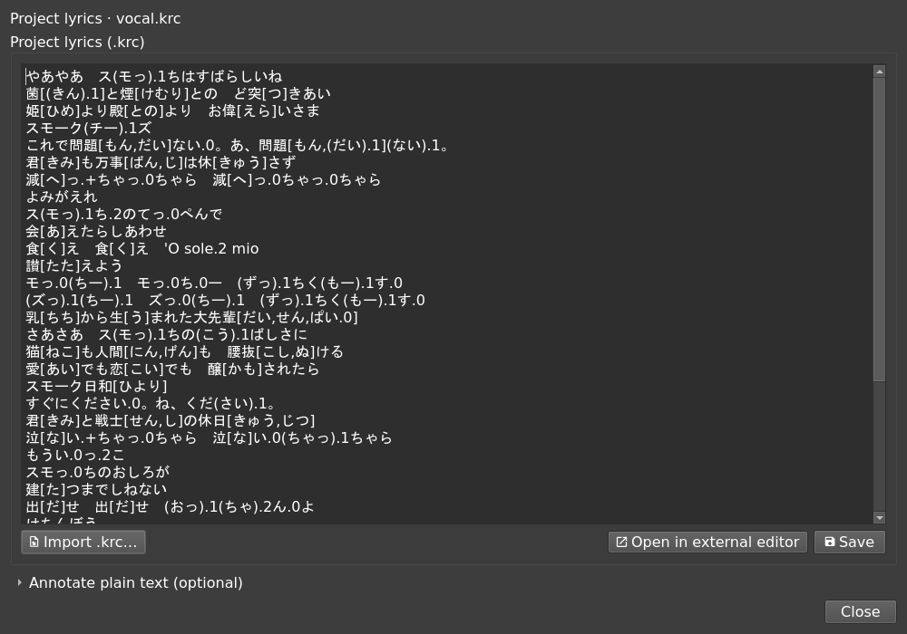
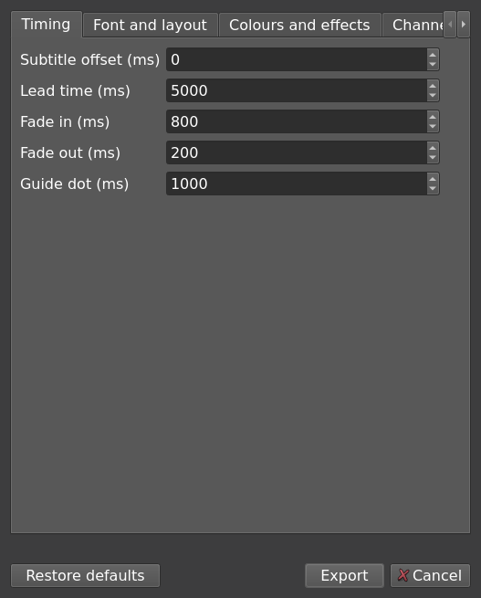

# Lyrics and karaoke

[README](../README.md) · [Editor guide](usage.md) · [CLI](cli.md)

## Add project lyrics

Open the lyrics window with the text-box button beside the GAME wand. The **Project lyrics
(.krc)** box is the authoritative text stored in the project.

1. Use **Import .krc…**, or paste KRC text into the project lyrics box.
2. Review the text and save it to the project.
3. Save the `.nto` to keep the lyrics with your notes.

For plain lyrics, expand the plain-text panel and paste text or use **Load text…** for
`.txt`, `.md` or `.lrc`. Then choose either:

- **Copy prompt**: paste the prompt into a model of your choice, then paste its answer into
  the project lyrics box.
- **Convert with the API**: configure an OpenAI-compatible API base (through `/v1`), key and
  model in Settings → Lyrics. The conversion streams output and validates the result before
  applying it. Invalid results are retried; an unsuccessful conversion leaves lyrics unchanged.

Conversion adds kana readings to kanji. Plain text is an input to conversion, not a replacement
for the project's KRC. The API key is stored in plain text in the settings file.



## Edit externally

**Open in external editor** opens a temporary UTF-8 `.krc` copy with the configured editor,
or the platform default. External saves are validated and reloaded without reopening the
project or running alignment. Broken external text remains available to fix, but the lyrics
window will not save invalid KRC into the project.

Temporary copies are removed when the document closes. Existing `.krc` files beside the
project are not modified; import them explicitly if needed.

## Map lyrics to notes

Lyrics follow the KRC's `.N` counts and shared-sound groups. Each channel consumes its own
notes in order. Editing text or notes does not automatically run alignment or rebuild the
mapping; inserting or deleting a note can shift subsequent lyrics.

The lyrics strip uses separate channel lanes above the roll. Green blocks sit on mapped
notes; red marks doubtful mapping; grey labels with no block consume no notes. Unmatched
labels have dashed outlines in the lower row.

| Gesture | Effect |
| --- | --- |
| Drag a boundary | Redistribute NOTE slots between adjacent units, preserving their total |
| Shift-drag left half | Exchange slots with the immediate left neighbour |
| Shift-drag right half | Change the unit's count without changing the next unit's count |
| Drag a Sound into an adjacent group | Join it while retaining the receiving group's NOTE count |
| Pull an edge Sound out of a group | Split it into an independent one-NOTE unit |
| Drag to the lower row | Drop a Sound to zero NOTE slots |
| Drag a zero-count label to upper empty space | Restore one NOTE slot |
| Right-click → Lyric channel | Change channel ownership |
| Escape | Cancel the gesture |

To split an edge Sound, release after crossing its group's boundary. To merge it elsewhere,
continue into the middle half of the receiving unit. Sound order never changes. Each gesture
changes the KRC in one undo step.

If notes run out, the display uses those available and preserves requested counts for later.
Incomplete mappings can be saved and edited, but cannot be exported as subtitles.


## Align against a vocal

Use a separated singing voice for alignment, not a full mix. With lyrics and audio loaded,
the clock button opens **Align** for the selected channel.

- **Auto-map** uses alignment while respecting explicit KRC counts and shared-sound groups.
- **Rebuild mapping** computes a structure without those constraints.
- **Quantize** optionally snaps the result onto the BPM grid.

Successful mapping updates KRC in one undo step without automatically saving the project.
Other channels retain their mapping and alignment evidence. Low-confidence results are marked
for review; the raw timing overlay lets you inspect evidence without changing it.

Model, device and quantize choices are remembered. Finished alignment is cached, so changing
BPM or grid offset can re-snap a result without rerunning the model. Evidence is saved in the
`.nto` alongside notes and lyrics.


For token-window input and headless alignment, see [CLI alignment](cli.md#align-a-vocal).

## Assign lyric channels

Use `@N{lyrics}` for MIDI channel `N` (0–15). Unwrapped lyrics use channel 0. The number is
the MIDI channel, not a track's position in the file.

```text
@0{あいう} @1{えお}
@1{
かき
くけ
}
```

Wrappers can span lines but cannot nest. Newlines still start new subtitle display lines;
inline wrappers keep text on the same line. Ruby, groups, NOTE counts, comments and chapter
breaks keep their meaning. A Sound or a shared-NOTE group must belong to one channel.
Different channels can sing simultaneously.

## Export lyrics and subtitles

Use **Export → Export lyrics (.krc)…** to write the current KRC, including its groups and
`.N` counts. Use **Export ASS subtitle…** for karaoke subtitles with syllable timing, ruby
and gaps between notes, including the header expected by Aegisub kara-templater.

GUI exports use the current lyric mapping. Set font, overlay colour, fades, lead time and
guide dot in export settings. In **Channel colours**, leave a channel blank to inherit the
global overlay colour.



For file-based exports, automatic rebuilding and session exports, see
[ASS command-line export](cli.md#export-ass-subtitles).
