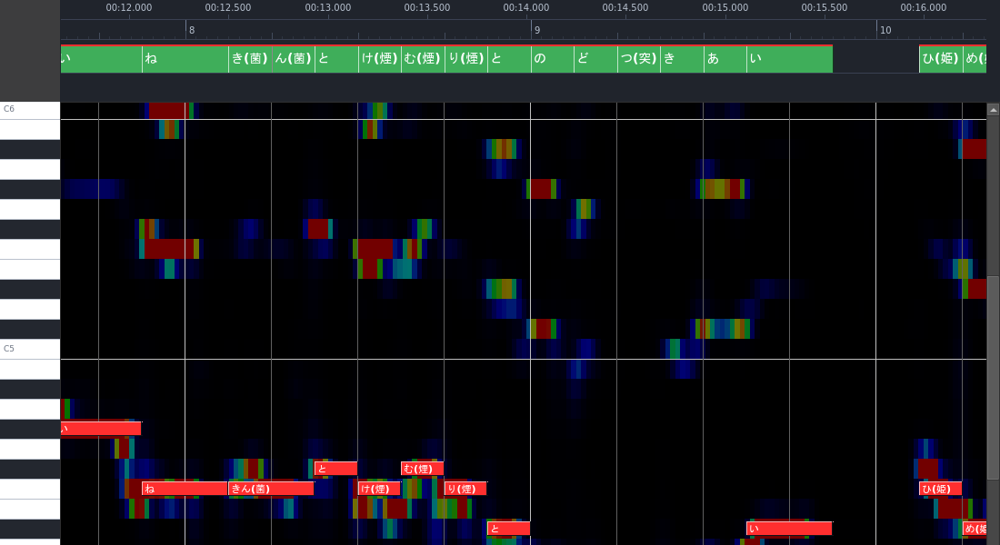
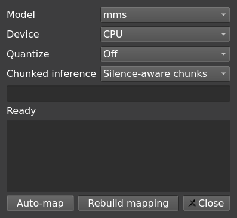

# Lyrics

[README](../README.md) · [Editor guide](usage.md) · [CLI](cli.md)

## The project's lyric text

A project keeps its lyrics inside the `.nto`, written in the ruby-annotated `.krc` syntax that is
the project's own way of storing the words: readings in `[ ]`, NOTE counts (`.N`), shared-sound
groups and `@N{…}` channel wrappers. The program reads and writes no lyric file of its own.

Open the lyrics window with the text-box button beside the GAME wand. Type or paste the text,
then **Save**: the project checks what it is given, and a text it cannot read is refused with
the reason in the status bar, leaving the stored lyrics unchanged. Save the `.nto` to keep the
lyrics with your notes.

Lines are edited on the roll too: right-click the lyrics strip and choose **Edit lyrics…** to
insert, delete or split lines, change a reading, or move a line to another channel. Lyrics after
a changed line may map to different notes, and an edit that changes NOTE consumption asks before
it applies.

## Map lyrics to notes

Lyrics follow the text's `.N` counts and shared-sound groups. Each channel consumes its own notes
in order. Editing text or notes does not automatically run alignment or rebuild the mapping;
inserting or deleting a note can shift subsequent lyrics.

The lyrics strip uses separate channel lanes above the roll. Green blocks sit on mapped notes;
red marks doubtful mapping; grey labels with no block consume no notes. Unmatched labels have
dashed outlines in the lower row.

| Gesture | Effect |
| --- | --- |
| Drag a boundary | Redistribute NOTE slots between adjacent units, preserving their total |
| Shift-drag left half | Exchange slots with the immediate left neighbour |
| Shift-drag right half | Change the unit's count without changing the next unit's count |
| Drag a Sound into an adjacent group | Join it while retaining the receiving group's NOTE count |
| Pull an edge Sound out of a group | Split it into an independent one-NOTE unit |
| Drag to the lower row | Drop a Sound to zero NOTE slots |
| Drag a zero-count label to upper empty space | Restore one NOTE slot |
| Right-click → Lyric channel | Change channel ownership |
| Escape | Cancel the gesture |

To split an edge Sound, release after crossing its group's boundary. To merge it elsewhere,
continue into the middle half of the receiving unit. Sound order never changes. Each gesture
changes the lyric text in one undo step.

If notes run out, the display uses those available and preserves requested counts for later. An
incomplete mapping can still be saved and edited, but the project reports when it cannot write
the mapping back into its lyric text.



## Align against a vocal

Use a separated singing voice for alignment, not a full mix. Save the project first: with
lyrics and audio loaded, the clock button then opens **Align** for the selected channel.

- **Auto-map** uses alignment while respecting explicit `.N` counts and shared-sound groups.
- **Rebuild mapping** computes a structure without those constraints.
- **Quantize** optionally snaps the result onto the BPM grid.

A successful mapping updates the lyric text in one undo step without automatically saving the
project. Other channels retain their mapping and alignment evidence. Low-confidence results are
marked for review; the raw timing overlay lets you inspect evidence without changing it.

Model, device and quantize choices are remembered. Finished alignment is cached, so changing
BPM or grid offset can re-snap a result without rerunning the model. Evidence is saved in the
`.nto` alongside notes and lyrics.



For token-window input and headless alignment, see [CLI alignment](cli.md#align-a-vocal).

## Assign lyric channels

Use `@N{lyrics}` for MIDI channel `N` (0–15). Unwrapped lyrics use channel 0. The number is
the MIDI channel, not a track's position in the file.

```text
@0{あいう} @1{えお}
@1{
かき
くけ
}
```

Wrappers can span lines but cannot nest. Newlines still start new lyric lines; inline wrappers
keep text on the same line. Ruby, groups, NOTE counts, comments and chapter breaks keep their
meaning. A Sound or a shared-NOTE group must belong to one channel. Different channels can sing
simultaneously.